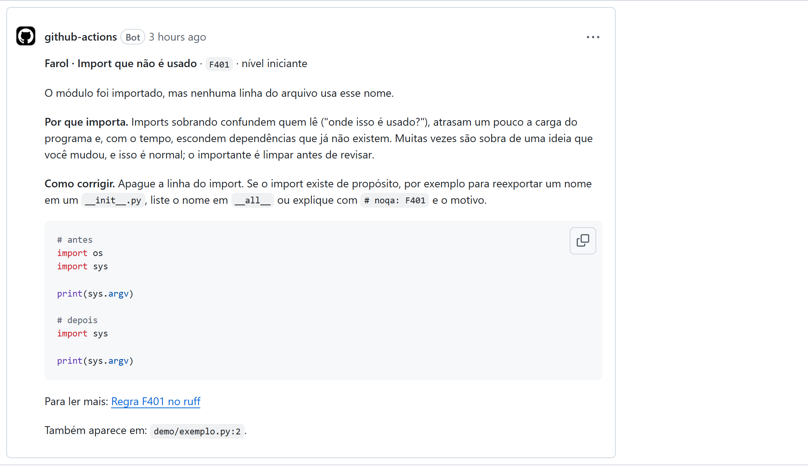
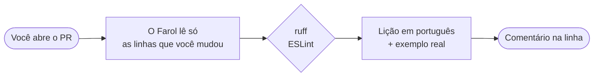
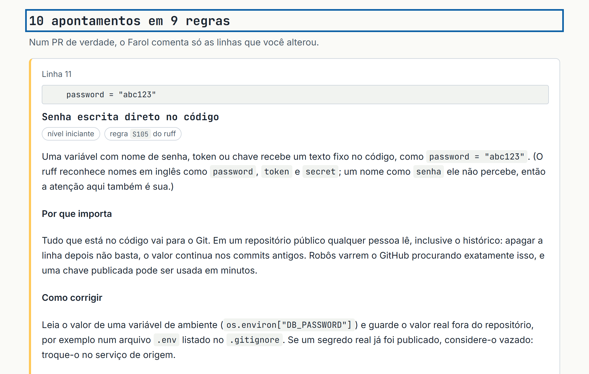

<div align="center">

<picture>
  <source media="(prefers-color-scheme: dark)" srcset="docs/assets/banner-dark.svg">
  <source media="(prefers-color-scheme: light)" srcset="docs/assets/banner-light.svg">
  
</picture>

<p>
  <a href="https://github.com/islan-max/farol/actions/workflows/ci.yml"></a>
  <a href="https://github.com/islan-max/farol/security/code-scanning"></a>
  <a href="https://github.com/islan-max/farol/releases/latest"></a>
  <a href="https://islan-max.github.io/farol/"></a>
  <a href="LICENSE"></a>
</p>
<p>
  
  
  
  
  
</p>

<p>
  <b><a href="https://islan-max.github.io/farol/teste.html">▶ Teste agora</a></b>
  &nbsp;·&nbsp; <a href="#-github-action">Action</a>
  &nbsp;·&nbsp; <a href="#-linha-de-comando">CLI</a>
  &nbsp;·&nbsp; <a href="#-as-lições">Lições</a>
  &nbsp;·&nbsp; <a href="#-documentação">Documentação</a>
  &nbsp;·&nbsp; <a href="CONTRIBUTING.md">Contribuir</a>
</p>

</div>

<br>

Quem está aprendendo abre um pull request e recebe **"LGTM"** ou nada. O lint aponta o erro e não explica. O **Farol** comenta cada ponto dizendo **o que é**, **por que importa** e **como corrigir**, e, em algumas lições, mostra **como projetos reais resolvem o mesmo caso**.

Sem chave de API, sem conta nova e sem executar o seu código. A análise vem do [ruff](https://docs.astral.sh/ruff/) e do [ESLint](https://eslint.org/); cada explicação é **escrita à mão, em português do Brasil, e testada**.

<div align="center">

<picture>
  <source media="(prefers-color-scheme: dark)" srcset="docs/assets/demo-dark.svg">
  <source media="(prefers-color-scheme: light)" srcset="docs/assets/demo-light.svg">
  
</picture>

</div>

## ✦ Um comentário de verdade

Isto é um comentário real do Farol, feito pela Action no [PR de demonstração #11](https://github.com/islan-max/farol/pull/11): na linha, com a explicação, o antes e o depois, e o link da documentação.

<div align="center">

<picture>
  <source media="(prefers-color-scheme: dark)" srcset="docs/assets/pr-comentario-dark.png">
  <source media="(prefers-color-scheme: light)" srcset="docs/assets/pr-comentario-light.png">
  
</picture>

</div>

## ✦ Como funciona



|  | Revisão comum | Com o Farol |
| --- | --- | --- |
| **O comentário** | "LGTM" ou a mensagem crua do lint | O que é, por que importa, como corrigir, antes e depois |
| **Ruído** | Um comentário por ocorrência | **Uma vez por regra e por arquivo**, no máximo 10 por PR |
| **Escopo** | O arquivo inteiro | **Só as linhas que você alterou** |
| **Segurança** | Se perde no meio dos outros avisos | Passa **na frente** quando o limite aperta |
| **Idioma** | Inglês técnico | Português do Brasil, com nível (iniciante a intermediário) |

## ✦ Comece em um minuto

### 🤖 GitHub Action

O caminho principal, grátis em repositório público. Não precisa de `actions/checkout`.

```yaml
# .github/workflows/farol.yml
name: Farol
on: pull_request
permissions:
  contents: read
  pull-requests: write
jobs:
  farol:
    runs-on: ubuntu-latest
    steps:
      - uses: islan-max/farol@v0
```

Opções, limites e segurança em [docs/usar-action.md](docs/usar-action.md).

### 💻 Linha de comando

Precisa do [uv](https://docs.astral.sh/uv/) e de um repositório git.

```bash
uvx --from git+https://github.com/islan-max/farol farol revisar            # o que mudou desde o último commit
uvx --from git+https://github.com/islan-max/farol farol revisar --base main # tudo desde que a branch saiu de main
uvx --from git+https://github.com/islan-max/farol farol explicar E722       # uma lição, sem diff
```

### 🌐 No navegador

> [!TIP]
> Cole um trecho de Python em **[Teste agora](https://islan-max.github.io/farol/teste.html)**. A análise roda na sua máquina (ruff em WebAssembly) e o código **não é enviado a ninguém**.

<div align="center">

<picture>
  <source media="(prefers-color-scheme: dark)" srcset="docs/assets/teste-agora-dark.png">
  <source media="(prefers-color-scheme: light)" srcset="docs/assets/teste-agora-light.png">
  
</picture>

</div>

## ✦ As lições

As lições são o produto. Em cada uma, o exemplo **"antes" dispara a regra na ferramenta e o "depois" não**, e isso é conferido por teste automático. Os exemplos reais são escolhidos à mão, com link para o commit e licença conferida.

<!-- licoes:inicio -->
<details>
<summary><b>Python</b> · 17 lições (ruff)</summary>

| Regra | Lição | Nível | Exemplo real |
| --- | --- | --- | :---: |
| [`B006`](https://islan-max.github.io/farol/licoes/B006.html) | Valor padrão mutável em argumento de função | intermediário | ✔ |
| [`B904`](https://islan-max.github.io/farol/licoes/B904.html) | Ao levantar outro erro dentro de `except`, use `raise ... from` | intermediário | ✔ |
| [`E711`](https://islan-max.github.io/farol/licoes/E711.html) | Compare com `None` usando `is` | iniciante |  |
| [`E712`](https://islan-max.github.io/farol/licoes/E712.html) | Não compare com `True` ou `False` | iniciante |  |
| [`E713`](https://islan-max.github.io/farol/licoes/E713.html) | Use `not in` em vez de `not ... in` | iniciante |  |
| [`E722`](https://islan-max.github.io/farol/licoes/E722.html) | `except:` sem tipo captura erro demais | iniciante | ✔ |
| [`E731`](https://islan-max.github.io/farol/licoes/E731.html) | Não atribua uma `lambda` a um nome | iniciante |  |
| [`E741`](https://islan-max.github.io/farol/licoes/E741.html) | Nome de variável fácil de confundir (`l`, `O`, `I`) | iniciante |  |
| [`F401`](https://islan-max.github.io/farol/licoes/F401.html) | Import que não é usado | iniciante |  |
| [`F541`](https://islan-max.github.io/farol/licoes/F541.html) | f-string sem nada para preencher | iniciante |  |
| [`F811`](https://islan-max.github.io/farol/licoes/F811.html) | Nome definido duas vezes: a primeira definição nunca é usada | intermediário |  |
| [`F821`](https://islan-max.github.io/farol/licoes/F821.html) | Nome que não existe nesse ponto do código | iniciante |  |
| [`F841`](https://islan-max.github.io/farol/licoes/F841.html) | Variável criada e nunca usada | iniciante |  |
| [`S105`](https://islan-max.github.io/farol/licoes/S105.html) | Senha escrita direto no código | iniciante | ✔ |
| [`S110`](https://islan-max.github.io/farol/licoes/S110.html) | `try`/`except` que engole o erro em silêncio | intermediário | ✔ |
| [`S113`](https://islan-max.github.io/farol/licoes/S113.html) | Chamada de rede sem `timeout` pode travar para sempre | intermediário |  |
| [`S608`](https://islan-max.github.io/farol/licoes/S608.html) | SQL montado juntando texto abre brecha para injeção de SQL | intermediário | ✔ |

</details>

<details>
<summary><b>JavaScript e TypeScript</b> · 10 lições (ESLint)</summary>

| Regra | Lição | Nível | Exemplo real |
| --- | --- | --- | :---: |
| [`eqeqeq`](https://islan-max.github.io/farol/licoes/eqeqeq.html) | Use `===` em vez de `==` | iniciante |  |
| [`no-dupe-keys`](https://islan-max.github.io/farol/licoes/no-dupe-keys.html) | Chave repetida em um objeto | iniciante |  |
| [`no-empty`](https://islan-max.github.io/farol/licoes/no-empty.html) | Bloco vazio, em especial `catch` que engole o erro | intermediário |  |
| [`no-eval`](https://islan-max.github.io/farol/licoes/no-eval.html) | Não use `eval`: ele executa texto como código | intermediário |  |
| [`no-explicit-any`](https://islan-max.github.io/farol/licoes/no-explicit-any.html) | Evite `any` no TypeScript | intermediário |  |
| [`no-fallthrough`](https://islan-max.github.io/farol/licoes/no-fallthrough.html) | `case` sem `break` cai no caso seguinte | intermediário | ✔ |
| [`no-unreachable`](https://islan-max.github.io/farol/licoes/no-unreachable.html) | Código depois de `return` nunca roda | iniciante |  |
| [`no-unused-vars`](https://islan-max.github.io/farol/licoes/no-unused-vars.html) | Variável ou import que nunca é usado | iniciante |  |
| [`no-var`](https://islan-max.github.io/farol/licoes/no-var.html) | Prefira `let` e `const` a `var` | iniciante |  |
| [`prefer-const`](https://islan-max.github.io/farol/licoes/prefer-const.html) | Use `const` quando o valor não muda | iniciante |  |

</details>
<!-- licoes:fim -->

## ✦ Opcionais (desligados por padrão)

<details>
<summary><b>IA local</b>: uma nota "No seu código" em cada comentário</summary>

<br>

Com `ia: ollama` o runner baixa o [Ollama](https://ollama.com) e um modelo pequeno, e o Farol acrescenta uma nota ligando a lição ao seu trecho, **rotulada como IA local que pode errar**. A IA nunca cria nem remove apontamentos, e se algo falhar o comentário sai só com a lição.

| | 1,5B (padrão) | 7B |
| --- | --- | --- |
| Notas boas (48 medidas) | 81% | 96% |
| Tempo por nota | 3,9 s | 17,4 s |
| Notas enganosas | 1 | 1 |

> [!NOTE]
> A classificação foi feita por quem escreveu as lições, então **não é independente**. Os números, os erros de cada modelo e as notas brutas estão em [docs/medicao-ia.md](docs/medicao-ia.md).

</details>

<details>
<summary><b>Painel do Farol</b>: o que se repete entre PRs</summary>

<br>

Com `painel: "on"` a Action mantém uma issue com, para cada pessoa, o que **se repete**, o que **apareceu agora** e o que **já parece dominado**. Guarda só o login, o número do PR e os códigos das regras. Veja o painel deste repositório na [issue #35](https://github.com/islan-max/farol/issues/35).

</details>

## ✦ Feito com rigor

| | |
| --- | --- |
| **Testes** | 178 testes de Python (lições, ferramentas, Action, CLI, IA, painel) e 84 testes do site |
| **Acessibilidade** | axe (WCAG 2.2 AA e boas práticas) nos temas claro e escuro, teclado, reflow a 640 e 320 px |
| **Desempenho** | Lighthouse no endereço final: 98 a 100 em desempenho e 100 em acessibilidade, boas práticas e SEO |
| **Em código real** | Rodado em requests, flask, click, express e sindresorhus/is; achou 4 falsos positivos, todos corrigidos ([relato](docs/avaliacao-em-codigo-real.md)) |
| **Segurança** | Só roda em `pull_request`, com permissões mínimas, nunca executa o PR; Actions fixadas por SHA; CodeQL e gitleaks no CI |
| **Honestidade** | O que **não** foi verificado está escrito em [docs/VERIFICACAO.md](docs/VERIFICACAO.md) |

## ✦ Documentação

| | |
| --- | --- |
| [Usar a Action](docs/usar-action.md) | Opções, permissões, PR de fork, painel e IA |
| [Usar a CLI](docs/usar-cli.md) | Comandos e opções |
| [Escrever uma lição](docs/escrever-licao.md) | Formato, tom, testes e exemplos reais |
| [Verificação](docs/VERIFICACAO.md) | Todos os módulos do guia de desenvolvimento, com evidência |
| [IA local](docs/medicao-ia.md) | Medições, erros e decisões |
| [Código real](docs/avaliacao-em-codigo-real.md) | Falsos positivos achados e corrigidos |
| [Contexto e decisões](docs/CONTEXTO.md) | Por que o projeto é como é |
| [O que ficou de fora](docs/fase-2.md) | Ideias adiadas |

## ✦ Contribuir

As lições são o melhor lugar para começar: escolha uma regra em [boas primeiras issues](https://github.com/islan-max/farol/labels/good%20first%20issue) e siga o [guia de contribuição](CONTRIBUTING.md). Ideias e dúvidas vão para as [Discussões](https://github.com/islan-max/farol/discussions).

```bash
uv sync && uv run pytest                 # precisa de Node.js 20+ para os testes de JavaScript/TypeScript
cd site && npm ci && cd ..               # site e testes de acessibilidade
uv run python scripts/build_site.py && npm run --prefix site test:a11y
```

## ✦ Licença

[MIT](LICENSE). Veja também o [código de conduta](CODE_OF_CONDUCT.md) e a [política de segurança](SECURITY.md).

<div align="center">

<br>

<sub>Feito por <a href="https://github.com/islan-max">@islan-max</a> para quem está começando · se o Farol ajudou, deixe uma ⭐</sub>

</div>
